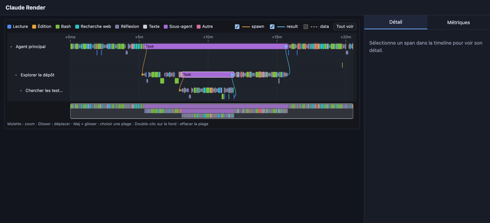
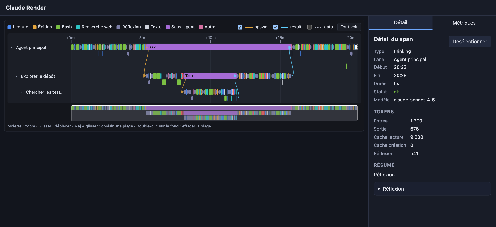
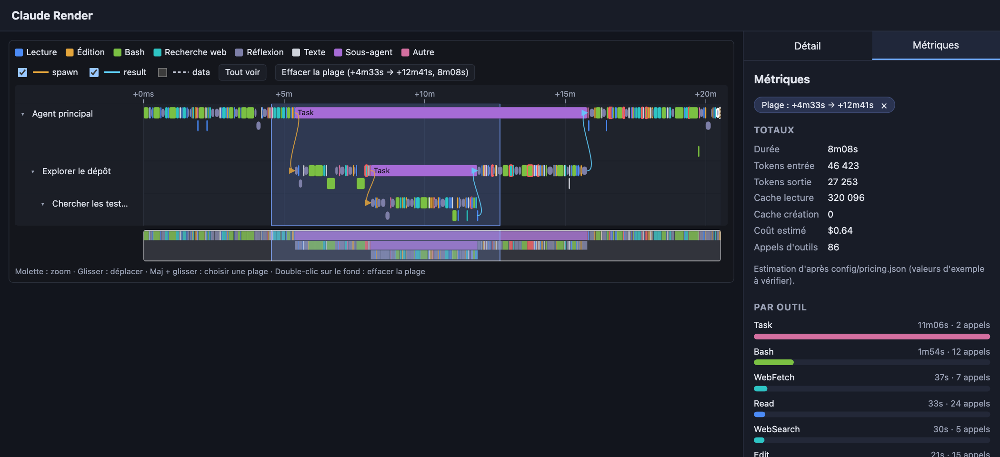

# Claude Render

🇫🇷 [Version française](README.fr.md)

A **local** web app that visualizes Claude Code's work from its session transcripts
(`~/.claude/projects/**/*.jsonl`). Nothing leaves your machine: the server only listens on `127.0.0.1`.

Two views:
- **Timeline** in swimlanes (main agent + one lane per subagent), with dependencies drawn as arrows;
- **Metrics**: duration, tokens, estimated cost, breakdown by tool and by agent, thinking vs. acting time, errors, repeated calls.



*Timeline: one lane per (nested) subagent, spans colored by tool category, `spawn` (orange) and `result` (blue) arrows, minimap at the bottom.*

| Span details | Metrics for a selected time range |
|---|---|
|  |  |

> Screenshots use the built-in demo data (no real session is shown). The UI is in French.

## Install and run

Requirements: Node 20+ (tested with Node 26).

```bash
npm install
npm run dev        # server (http://127.0.0.1:3001) + UI (http://localhost:5173)
```

Other commands:

```bash
npm test           # vitest tests
npm run typecheck  # TypeScript check
npm run build      # build the front end into dist/client (then served by the Express server)
```

Environment variables: `PORT` (default 3001), `CLAUDE_PROJECTS_DIR` (default `~/.claude/projects`).

## Usage

- Pick a session at the top (sorted by date).
- Mouse wheel = zoom, drag = pan, **Shift + drag** = select a time range (the metrics follow it).
- Click a block for its details on the right; click a lane name to filter the metrics on that subagent.
- Subagent lanes can be collapsed (▸/▾).

## Structure

```
src/shared/types.ts   data model (Session, Lane, Span, Dependency, Metrics...)
src/shared/metrics.ts metrics computation (pure function, used on the client side)
src/server/parser.ts  JSONL -> Session parser (tested)
src/server/sessions.ts, index.ts   session listing / loading, Express API
src/client/           React UI (timeline/ = hand-made SVG, d3-scale for the scales only)
config/pricing.json   price table per model (to adjust, see below)
tests/                vitest tests + hand-written fixtures
```

API: `GET /api/sessions`, `GET /api/sessions/:id`, `GET /api/pricing`.

## Estimated cost

Transcripts do **not** contain the cost in dollars. It is computed from `config/pricing.json`
(dollars per million tokens, per model prefix). **The provided values are examples**:
check and adjust them before relying on them.

## Known limitations (caused by the data)

- **Thinking content is unavailable**: `thinking` blocks are empty in the transcripts. Only their duration
  (`thinkingDurationMs`) and token count are known, so thinking cards show no text.
- **Approximate durations**: a line has a single timestamp. A tool lasts from its `tool_use` to its `tool_result`;
  a text block is estimated from the previous line; the position of a thinking block is derived from its duration.
- **Background subagents**: their real end comes from a `task-notification` sent to the parent. If it is missing
  from the transcript, the agent stays shown as "running" rather than inventing an end.
- **Synchronous subagents**: not observed in the transcripts used to write the parser (all were asynchronous);
  their handling is not verified on real data.
- **`data` dependencies**: a file written (Write/Edit) then read (Read) later. This is a heuristic on file paths:
  nothing proves the read actually used the written data. A write is only linked to the first read that follows.
- **Tokens**: usage is copied onto every line of the same API request; it is counted once per request
  (carried by its first span). On a narrow time range, the cost may therefore be attributed to a different interval
  than the actual call.
- **Undocumented format**: the transcript format may change with Claude Code versions.
- Visual rendering was checked on a Chromium run (screenshots) and unit tests, not on Safari or Firefox;
  performance on very large sessions (thousands of spans) is not measured in a browser.

## License

MIT
